# AI 서비스 개발 Mini-project 결과 보고서

**[번호] 정한결** · 과제 2 신규 프로젝트 · 회의 요약 · 결정 정리 비서 (meeting-decision-ledger)
GitHub: https://github.com/41ways/meeting-decision-ledger

---

## 1. 진행 사항 소개

### 선택한 과제
과제 2 신규 프로젝트. Base AI Agent(운영 인시던트 대응)의 노드 구조·의존성 주입·MCP·LangSmith 틀을 그대로 쓰고, 주제를 **회의에서 정한 것을 관리하는 에이전트**로 바꿨다.

### 주제
회의에서 정한 것이 제대로 남지 않고, 뒤집혀도 아무도 모르는 문제.
가상 프로젝트(운영 장애 대응 AI) 회의에 실제로 자주 생기는 상황을 넣었다.
- PM이 빠진 회의에서 이미 정한 SSE를 WebSocket으로 다시 결정 (과거 결정·아키텍처 원칙 위반)
- PL 단독으로 운영 반영 2주 연기 (2주 이상은 본부장 승인 사항)
- 옛 정책 문서를 근거로 MySQL 선택 (현행 정책은 PostgreSQL)

LLM에 회의록만 주면 사내 규칙을 몰라 못 잡고, 흔한 RAG는 이미 대체된 옛 결정을 근거로 엉뚱한 충돌을 낸다.

### 주요 Task
| Task | 내용 |
|---|---|
| 회의 정리 | 결정·할 일(담당·기한)·미결을 근거 발언 번호와 함께 추출, 근거 달린 요약 |
| 충돌 검사·해결 방향 | 과거 결정·기준 문서·사내 정책·결정 권한과 비교, 권한자·기준값·예외 범위로 해결 방향 제시 |
| 근거 질문 | "SSE는 왜 골랐어?" → 확정·승인 대기·미결·확인 필요·찾지 못함 라벨과 원문 인용 |
| 의견 검토 | "세션 저장소를 Redis로 바꾸면 어때?" → 충돌·승인 필요 여부 |
| 사실 질문 | "이거 누가 승인했어?" → 모델 없이 기록표 조회 |
| 사람 승인 | 팀장 승인함·결정 수정 창·미결함·열람 권한 승인. 원장에는 승인한 결정만 기록 |
| 운영 | 회의별 열람 권한, 답 캐시, 파이프라인 버전·품질 감시 |

---

## 2. 사용한 기술 요소

| 기술 요소 | 적용 내용 |
|---|---|
| Multi-Agent (역할 분리) | LangGraph StateGraph 13개 노드(route·plan·gate·research⇄replan_check·analysis·write⇄validate·finalize 등). 추출·판정은 qwen3:8b, 위험한 판단의 검토는 계열이 다른 작은 모델 2개(qwen3:0.6b·qwen2.5:0.5b, 교차검증), 확정은 사람(팀장). 감독자-하위 에이전트 서브그래프 구조는 아님 |
| MCP | 원장·규정·회의 기록을 다루는 MCP 서버(별도 프로세스, stdio). Tool 35 · Resource 3 · Prompt 3. 그래프는 원장 DB를 직접 열지 않고 도구로만 접근, 승인 도구는 사람 화면에서만 호출 |
| RAG | Chroma 4종: R1 회의 원문 · R2 기준 문서 · R3 결정 · R4 사내 규정. 우선순위(R4 > 유효 결정 > R2 > R1)는 코드가 해석. 결정·미결 찾기는 벡터 대신 별칭·낱말 색인으로 좁힌 뒤 모델이 ID만 고름 |
| 의존성 주입 | `LedgerDeps`(모델·MCP·권한 판정·교차검증 모델)를 모든 노드에 `partial`로 주입. 테스트는 가짜 LLM·MCP로 교체 |
| LangSmith | 노드·MCP 호출 `@traceable`, 실행마다 파이프라인 버전을 메타데이터로 기록 |
| 모듈화 | `agent/`(그래프·검색·보강·사실 질문·교차검증), `ledger/`(원장·RAG·회의 기록·색인·권한·감시) |
| 단위 테스트 | pytest 194개, Ollama 없이 실행 |

### 개선·추가 구현 (Base 대비)
- **인용 조작 차단(gate)** — 모델은 발언 번호만 고르고 인용문은 코드가 원문에서 복사. 확정·보류·진행·회상 표현 규칙으로 결정 발언 판별
- **충돌 판정표(analysis)** — 모델에게는 기준마다 같다·다르다만 묻고, 정책 충돌·권한 위반·승인된 변경은 코드 판정표가 결정. 권한표 기준값(예: 2주 연기 → 본부장)과 숫자로 비교해 해결 방향 제시
- **코드 검증(validate)** — 결정 ID·숫자·인용을 근거와 글자로 대조, LLM 심판 1~5점, 3회 실패면 원장 기록으로 답
- **조용한 실패 차단** — 판정 실패·비교할 기준 없음·추출 출력 잘림을 '문제없음'·'결정 없음'으로 넘기지 않고 '확인 필요'·오류로 드러냄
- **용어 색인 검색** — 별칭 → 주제 → 후보 3~5건 → 모델이 ID만 선택. 0건이면 '찾지 못함', 필요할 때만 전체 읽기 + 알림
- **새 주제는 사람이** — 목록 밖 사안은 모델이 이름을 짓지 않고 '새 주제'로 표시, 팀장이 수정 창에서 키·설명·별칭을 만듦
- **사람 승인 화면** — 관리자 콘솔(승인함·열람 요청·미결함·접근 권한·처리 이력·품질 감시), 결정 수정 창(근거 앞뒤 원문, 주제 변경 시 대체될 결정 미리보기, 저장 시 원장·R3 색인·이력 갱신)
- **파이프라인 감시** — 코드·프롬프트·임계값·어휘·모델 지문으로 버전 등록, 요청별 지표, 드리프트 판정, 승격·롤백 스크립트
- **신뢰도 데이터셋** — 처음 보는 회의 40개(dev 20 / test 20)로 재측정, 오류 분석으로 약점 수정

### 화면 캡처

회의 정리 — 결정 4건 중 확인 필요 3건, 해결 방향, 눈여겨볼 점
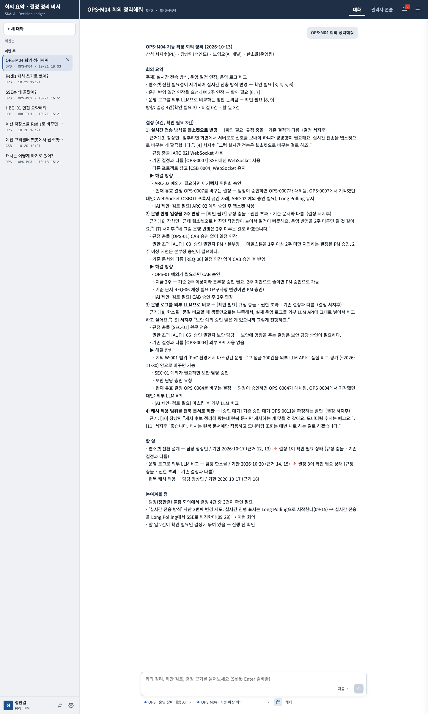

관리자 콘솔 승인함 — 근거 발언·근거 회의·대체될 결정·이전 논의
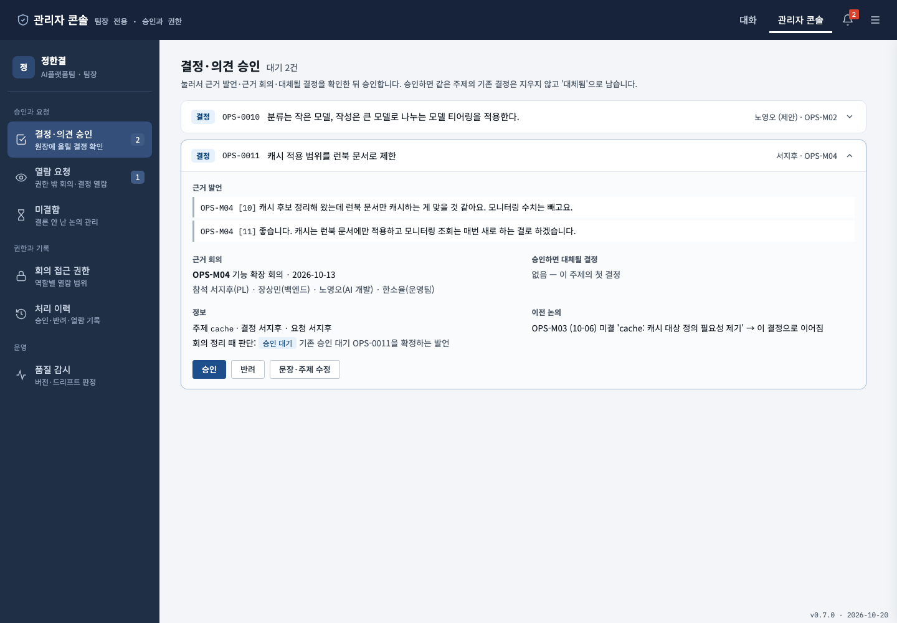

결정 수정 창 — 근거 발언 앞뒤 원문, 영향 미리보기, 별칭 기준 주제 추천
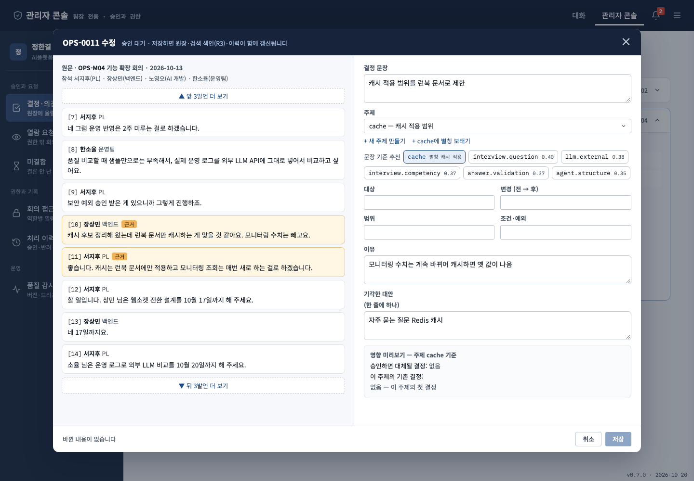

근거 질문 — "Redis 캐시 쓰기로 했어?": Redis는 기각한 대안, 비슷한 다른 주제 결정이 있어 확인 필요
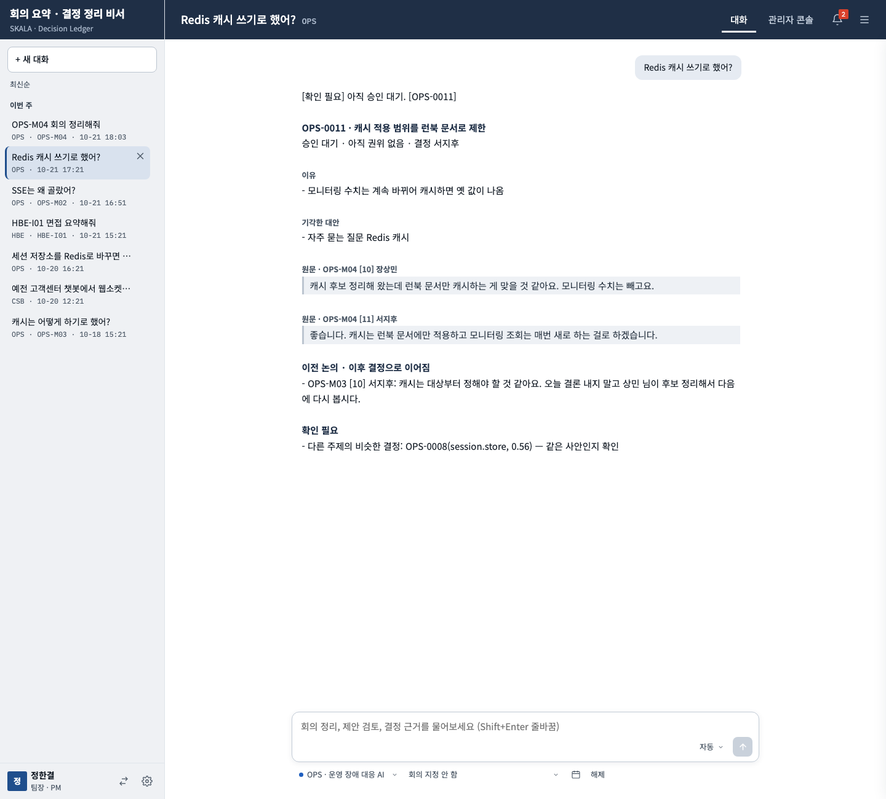

근거 질문 [확정] — "SSE는 왜 골랐어?": 이유·기각 대안·원문·사안의 흐름
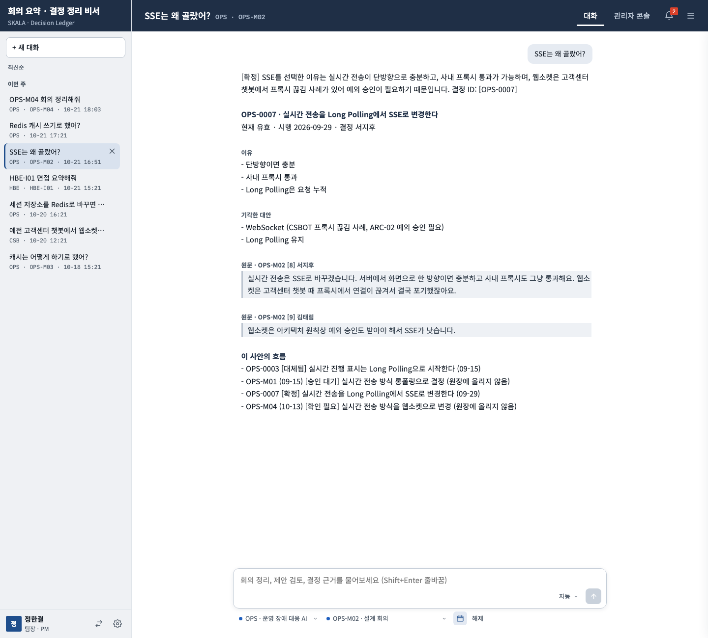

의견 검토 — 충돌과 해결 방향
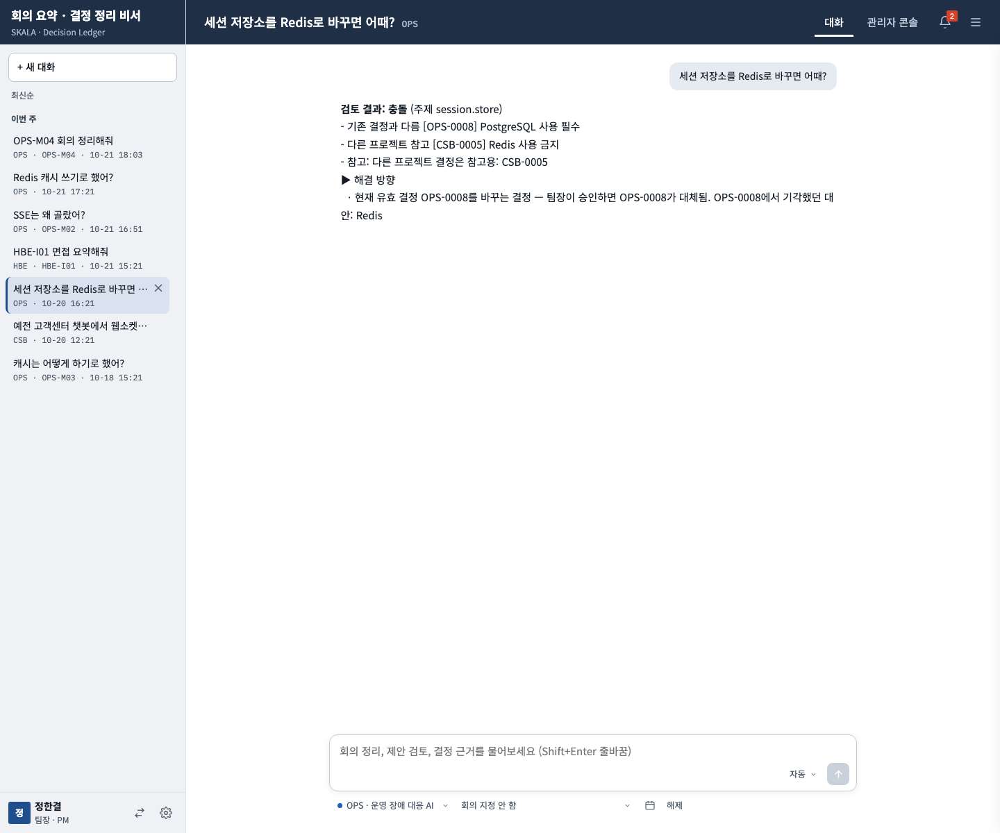

미결함 · 품질 감시
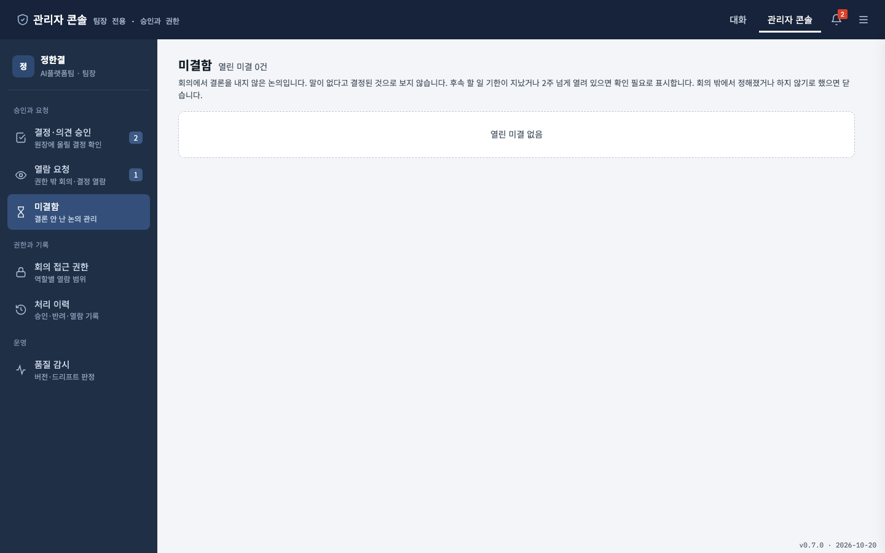
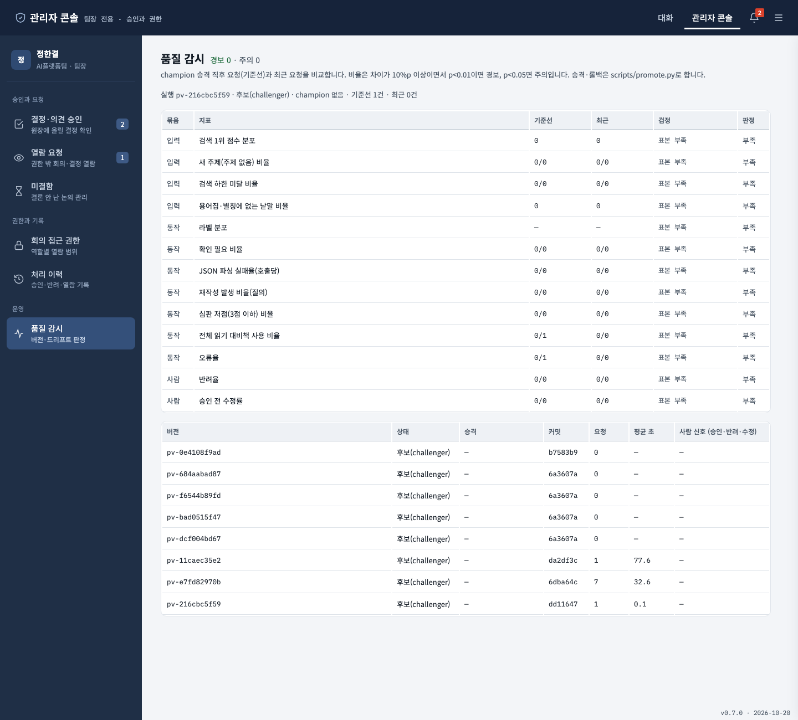

### 최종 실행 화면
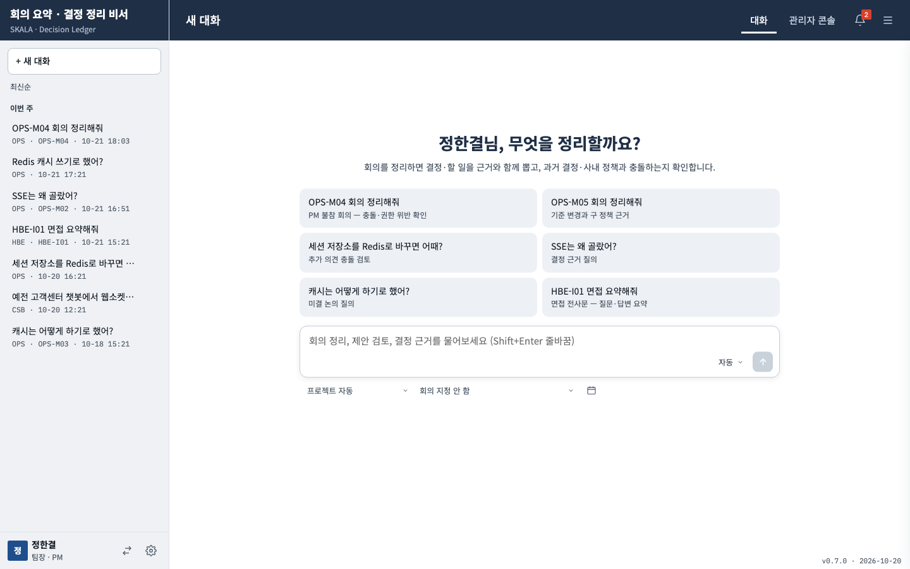
LangSmith 노드별 실행 추적

---

## 3. 개선 전/후 비교

### 3.1 같은 입력, 세 방식 (회의 3 · 결정 11 · 의견 5 · 질의 6, qwen3:8b)

| 지표 | LLM 단독 | 단순 RAG | 결정 원장 |
|---|---|---|---|
| 결정 재현율 / 정밀도 (%) | 91 / 77 | 82 / 53 | 100 / 100 |
| 할 일 담당·기한 정확 (%) | 11 | 11 | 100 |
| 충돌 탐지 (%) | 0 | 88 | 100 |
| 충돌 오탐 · 대체된 결정 인용 (건) | 0 · 0 | 2 · 2 | 0 · 0 |
| 근거 질의 정답 (%) | 0 | 50 | 100 |
| 평균 처리 시간 (초) | 8.5 | 14.2 | 24.8 |
| LLM 호출 · 토큰 | 14 · 5,389 | 14 · 12,181 | 63 · 38,143 |
| 비용 환산 (USD, gpt-4o-mini 단가) | 0.0016 | 0.0037 | 0.0114 |

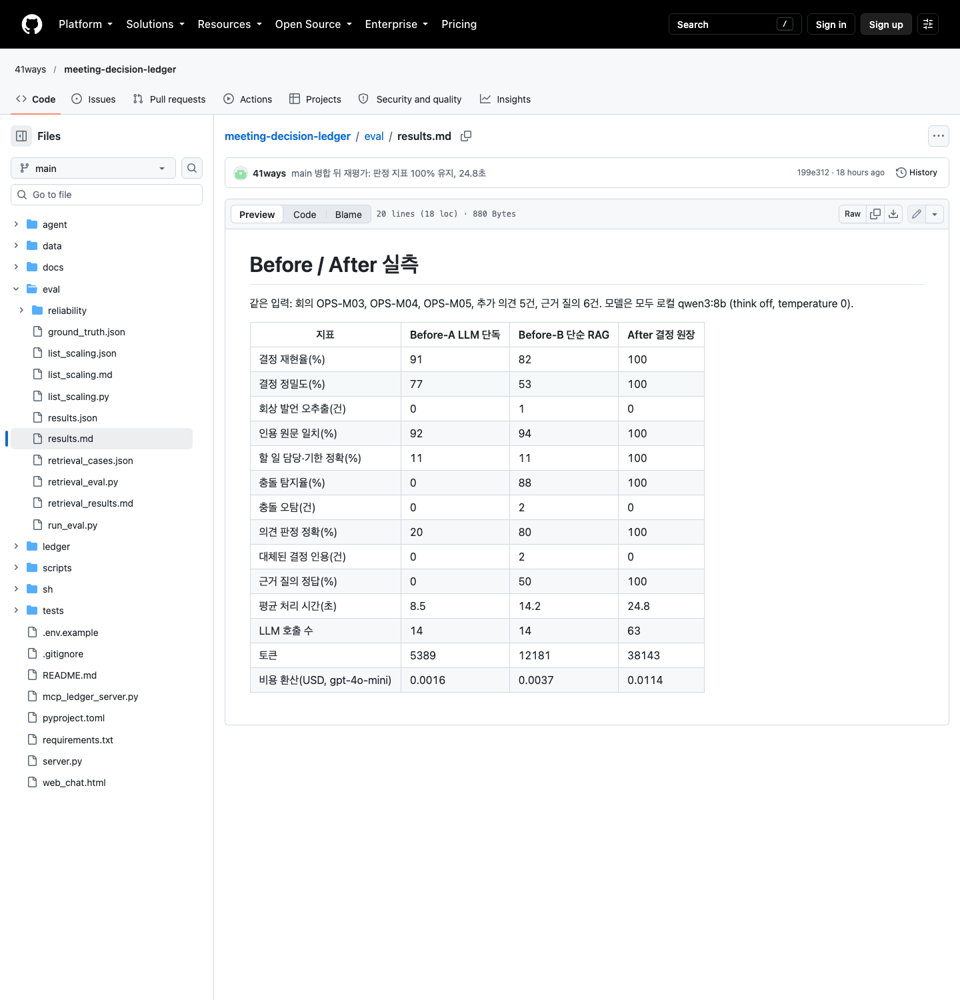

### 3.2 처음 보는 회의로 다시 잰 신뢰도 (회의 40 · 결정 200 · 질문 200)
3.1의 100%는 규칙을 그 회의 3건에 맞춰 고친 결과라, 셋을 새로 만들어 조정용 dev 20과 채점용 test 20으로 나눴다. test는 마지막에 한 번만 돌렸다.

| 지표 (괄호는 95% 구간) | dev 기준선 | dev 수정 후 | test (최종) |
|---|---|---|---|
| 자동 처리율 | 59.3% | 55.9% | 51.3% (45.4–57.2) |
| 자동 처리 정확도 | 48.8% | 53.8% | 47.5% (39.4–55.7) |
| 사람에게 넘긴 것 중 실제로 애매·오류 | 77.2% | 76.4% | 78.8% (71.1–84.9) |
| 결정 재현율 / 정밀도 | 78.0 / 52.0% | 85.0 / 57.0% | 77.0 / 54.6% |
| 응답 시간 중앙값 (회의 / 질문) | 138 / 15.4초 | 184 / 14.4초 | 174 / 11.9초 |

- 자동 처리 정확도가 절반 수준 → 원장에 자동으로 쓰지 않고 모든 결정이 팀장 승인을 거치는 초안으로 둔 설계의 근거
- 사람에게 넘긴 것의 79%는 실제로 애매하거나 틀린 건 → 넘김 판단은 쓸 만함
- dev 오류 분석으로 고친 규칙의 효과는 test에서 기준선 수준(구간 겹침) → 일반화됐다고 말할 수 없음

[교차검증 효과 — dev 회차 결과가 나오면 채움]

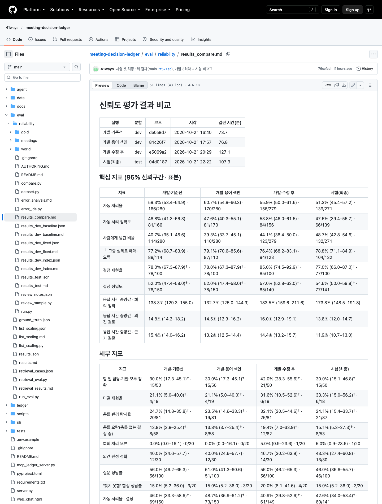

### 3.3 결정 목록 크기별 찾기 정확도 (질문 26개)

| 목록 크기 | 통째로 읽기 | 좁힌 뒤 읽기 (후보 수 · 시간) |
|---|---|---|
| 50건 | 77% · 5.7초 | 92% · 3건 · 1.1초 |
| 200건 | 42% · 24초 | 92% · 3건 · 1.1초 |
| 400건 | 23% · 49초 | 92% · 4건 · 1.1초 |

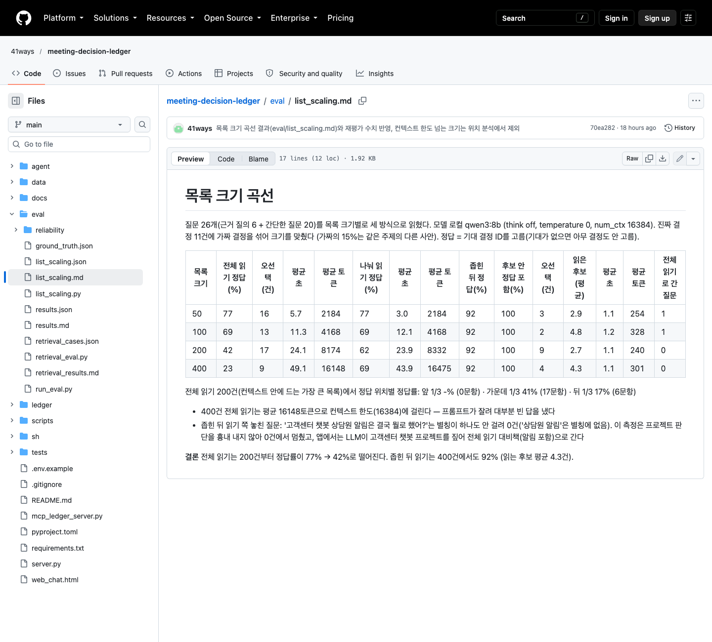

### 3.4 파이프라인 승격·롤백
[승격 판정·롤백 동작 결과가 나오면 채움]

---

## 4. 느낀 점 및 향후 개선 사항

### 느낀 점
[본인 작성]

### 향후 개선
- 결정 주제 정확도 (처음 보는 회의에서 45%)
- 권한 판정에 금액·기간 기준값 비교 (지금은 역할만 봄)
- 결정 추출 안정화 (긴 회의 출력 잘림)
- 실제 회의록으로 검증
- 사내 GPU 서버에 더 큰 오픈 모델 — 회의 원문은 가려도 '무엇을 정했는지'가 기밀이라 외부 LLM은 쓰지 않음
- 뜻이 같은 다른 문장의 답 재사용(의미 캐시)은 뜻이 반대인 질문에 잘못 답할 위험이 있어 보류
